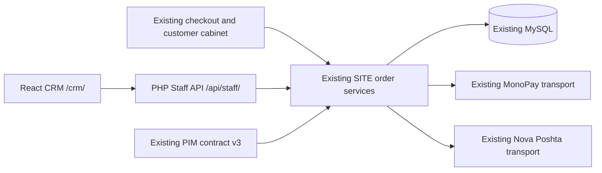

# CRM architecture

The CRM at `/crm/` is a static React 19 / TypeScript / Vite application. It uses the same origin `/api/staff/*` PHP 8.2 API. Production needs no persistent Node process. SITE owns the single MySQL order domain; CRM adds staff operations to it. PIM contract v3 continues to own product identity, availability, price and fulfillment supplier data.

`staff/bootstrap.php` starts a separate staff session and reads the prepared schema. `staff/auth.php` performs authentication and permissions; `staff/read.php` returns bounded canonical DTOs and batch reads; `staff/operations.php` delegates confirmations, invoices and shipments to existing SITE services. `staff/refunds.php` adds a durable partial refund operation ledger to the existing invoices. `staff/reports.php` projects actual payment facts. There is no alternate order, item, customer, reservation or shipment repository.

`shop/crm-bridge.php` makes the extension compatible with SITE-only releases. If the database has enabled CRM but its required files are missing, payment integration fails closed. Roll out the complete SITE release, never only the API entry point.

The frontend has one canonical order implementation for legacy and v3. React Query cancels stale search requests, caches read data and invalidates mutations. Versions are server hashes of the order and its dependencies; optimistic mutations reject `STALE_ORDER`. Financial effects use the existing named order lock, SQL transactions and durable provider operation intents. Remote side effects never run inside a long SQL transaction.

See [domain map](CRM-DOMAIN-MAP.md), [permissions](CRM-PERMISSIONS.md), [business rules](CRM-BUSINESS-RULES.md), [deployment](CRM-DEPLOY.md).
