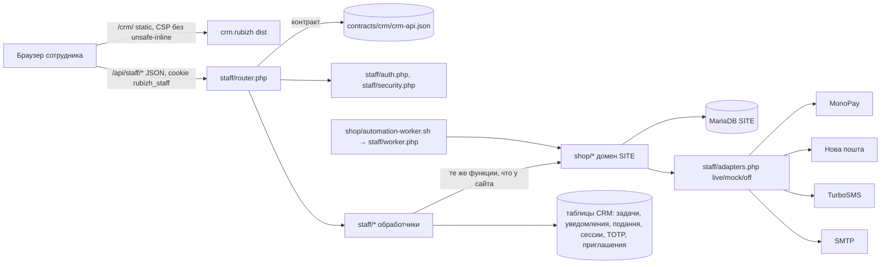

# CRM РУБІЖ — архитектура (этап 4)

Основа: [00-CRM_GAP_ANALYSIS](00-CRM_GAP_ANALYSIS.md). Принципы A1–A9 ТЗ этапа 4 обязательны; ниже — как они реализованы.

## Компоненты

## Решения

1. **Размещение**: `/crm/` на домене магазина сохраняется (gap-анализ не выявил причин менять). Отдельная cookie `rubizh_staff` (Secure, HttpOnly, SameSite=Strict, path `/api/staff`), отдельный API `/api/staff/*`, `Cache-Control: no-store`, `X-Robots-Tag: noindex`.
2. **Контракт-первым**: `contracts/crm/crm-api.json` — единственный источник маршрутов: метод, путь, право, step-up, обязательная версия заказа, идемпотентность, JSON Schema запроса и ответа. Роутер `staff/router.php` исполняет его; RBAC-матрица ([03](03-RBAC_MATRIX.md)) и API ([04](04-CRM_API.md)) генерируются из него (`dev/crm-contract-docs.mjs`); типы TS генерируются в `crm.rubizh/src/contract.gen.ts`; contract-тесты сверяют ответы со схемами.
3. **Изменяющее действие (A7)**: `роль/право → step-up (если указан) → expected_version (409 STALE_ORDER) → Idempotency-Key (заголовок, 32 hex, на попытку) → npLocked + транзакция → audit (кто, роль, что, было/стало, причина, IP-хеш, request_id)`. Ключ идемпотентности хранится в `rubizh_crm_idempotency` с хешем тела: повтор того же ключа с тем же телом → сохранённый ответ; иное тело → 409 `IDEMPOTENCY_CONFLICT`; после 5xx клиент обязан выдать новый ключ на новую осознанную попытку (M-11).
4. **Бизнес-логика только в SITE (A2)**: CRM-обработчики вызывают функции `shop/*`. Недостающие функции добавляются в SITE и используются обоими каналами: `shopCreateOrder` (оформление сайта и телефонный заказ), `shopConfirmLine`, `shopReplaceLine`, `shopRemoveLine`, `shopTransferToPacking`, `shopCompleteOrder`, `shopUpdateDelivery`, `shopAssignLineSupplier`, `npManualDeliver`, `shopAcceptInvoicePayment` (D-51).
5. **Деньги (A3, A8)**: «оплачено» — только `monoApplyEvent` (подписанный webhook / подтверждённое банком чтение) или `shopAcceptInvoicePayment` для оплаты по счёту ФОП (выписка банка, OWNER/ACCOUNTANT, step-up). Кнопки «зарахувати оплату» для карты нет. Суммы в API — целые копейки (`*_minor`), валюта 980; время — UTC ISO-8601, отображение Europe/Kyiv.
6. **Доставка (A4)**: статусы — только `npRefresh`/cron по ответу НП; исключения — `npManualDeliver` (OWNER, step-up, причина, пометка `manual` в истории) и `npResolveUnknown` (R6).
7. **Без наложенного платежа (A5)**: `npSaveProperties` никогда не содержит `BackwardDeliveryData`/`AfterpaymentOnGoodsCost` (проверка перед вызовом НП, тест); тексты/API/данные проверяются поиском по сборке.
8. **Права на сервере (A6)**: каждый маршрут контракта имеет право; MANAGER меняет только свои и неназначенные заказы (`crmOrderScope`), чужие — только просмотр/переназначение с причиной; WAREHOUSE не получает финансовых полей (`crmRedact`); ответы списков фильтруются по роли.
9. **Адаптеры (A9)**: `crmFeature(name)` → `live` (флаг ВКЛ), `mock` (staging + mock-транспорт), `off` (production без флага → 409 `FEATURE_NOT_CONNECTED` «Функція ще не підключена»). Флаги по умолчанию ВЫКЛ: `crm_enabled`, `crm_refund_live`, `crm_np_ttn_live`, `crm_np_tracking_live`, `crm_sms_live`, `crm_email_live` (CONFIG.md).
10. **Своё у CRM (A1)**: `rubizh_crm_tasks`, `rubizh_crm_notifications`, `rubizh_crm_saved_views`, `rubizh_staff_sessions`, `rubizh_staff_totp`, `rubizh_staff_invites`, `rubizh_crm_idempotency`, `rubizh_crm_settings`, `rubizh_crm_payment_reviews`; комментарии и audit — существующие append-only таблицы.
11. **Лимиты (R8/PL-1)**: неудачные входы — ключ IP+аккаунт, без вечной блокировки; API — ключ сессии сотрудника (не IP), поэтому офис за одним IP не блокирует коллег; тестовый стенд использует отдельные адреса/сессии, production-правила не ослабляются.
12. **Фронтенд**: React 19 + Vite 7; маршруты разделены code-splitting по разделам; токены макета в CSS-переменных; светлая тема по умолчанию; production-сборка без inline-стилей и скриптов (CSP без `unsafe-inline`); демо-данных в сборке нет.

## OWNER DECISION (временно приняты обратимые варианты)

| ID | Вопрос | Временное решение | Рекомендация |
|---|---|---|---|
| OD-4.1 | Себестоимость для валовой прибыли: PIM считает `payout`, но в SITE её не передаёт (`api/lib.php:211` вырезает); PIM менять запрещено | Формула реализована и протестирована; источник — приватная таблица SITE `rubizh_crm_sku_costs`, наполняется только будущим контрактом PIM; пока пусто — KPI «Валовий прибуток» показывает «Немає даних собівартості від PIM» | **Решено владельцем (этап 5, 2026-10-16): себестоимость передаётся из PIM.** PIM отдаёт выплату поставщику по SKU отдельным приватным контрактом `contracts/pim-private-costs/1` в `POST /api/pim/costs` (только с `pim_key`) после зафиксированной публикации; SITE хранит её в `rubizh_crm_sku_costs`, ни в одном публичном ответе её нет; «Валовий прибуток» видят OWNER и ACCOUNTANT; формула 05 не менялась |
| OD-4.2 | Роли: в SITE LOGISTICS/READ_ONLY | Миграция LOGISTICS→WAREHOUSE, READ_ONLY→SUPPORT, новая ACCOUNTANT; старые значения в конфиге — алиасы | **Принято владельцем как реализовано (этап 5)** |
| OD-4.3 | «У комплектації» | Фактический статус SITE `processing` (не новый) | **Принято владельцем как реализовано (этап 5)** |
| OD-4.4 | Абсолютное время сессии | 12 ч (ТЗ), было 8 ч | **Принято владельцем как реализовано (этап 5)** |
| OD-4.5 | Телефонный заказ и аккаунт | Привязка к аккаунту только после SMS-входа покупателя с тем же номером (таблица `rubizh_phone_order_claims`) | **Принято владельцем как реализовано (этап 5)** |
| OD-4.6 | D-54 (оптовая заявка) получен обрезанным | **Решено владельцем (этап 4.1):** полное требование выполнено — форма с кнопкой «Надіслати запит», поле-ловушка, «Дякуємо, заявка № …», лимиты; CRM: статусы нова/в роботі/КП надіслано/закрита, назначение, комментарии, аудит, заказ из заявки через сервис заказов SITE | Закрыто |
| OD-4.7 | Пороги сегментов клиентов, автозадач | Настройки OWNER со значениями по умолчанию: VIP ≥ 3 оплаченных заказа или ≥ 20 000 ₴; автозадача — заказ без подтверждения > 30 мин, посылка без ТТН > 24 ч | **Принято владельцем (этап 5): значения по умолчанию** — VIP ≥ 3 оплаченных заказа или ≥ 20 000 ₴; автозадачи: без подтверждения > 30 мин, посылка без ТТН > 24 ч |
| OD-4.8 | E2E 1 (§10.1): ручное «Завершити» после доставки | SITE RC1 (`shop/np-fulfillment.php`) сам завершает оплаченный заказ v3, когда доставлены все посылки; кнопка «Завершити» — для остальных случаев; E2E 1 нажимает её, только если доступна, и проверяет итог «завершене» | **Принято владельцем как реализовано (этап 5)** |
| OD-4.9 | Блок 4-SITE был обрезан на D-54 | **Решено владельцем (этап 4.1):** получен текст D-55…D-64, все выполнены (D-55…D-60, D-62…D-64 — этап 4.1; D-61 — этап 4); собственные находки этапа 4 переименованы (S4-*, PERF-*) | Закрыто |
| OD-5 D-62 | Страницы групп «Бронезахист» и «Спорядження» | Этап 4.1: `/categories#раздел` | **Решено владельцем (этап 5, 2026-10-16):** отдельные индексируемые страницы `/rozdil/bronezakhyst`, `/rozdil/sporiadzhennia` (H1, текст, подкатегории, товары, canonical, sitemap, хлебные крошки); `?roots=` → 301, старые `/categories#ac-…` групп → переход на страницу группы |
| OD-5 D-65 | Бронезахист и цена комплекта | Q-8 давал kit-цену любому разделу | **Решено владельцем (этап 5):** бронезахист — фиксированная цена, kit-цена на него не применяется, но раздел засчитывается в K1; оферта дополнена; старые заказы не пересчитываются |
